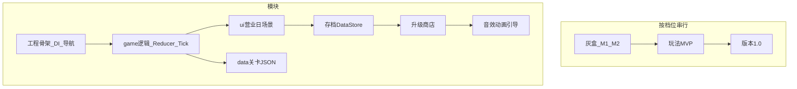

# 《热干面传奇》Agent 推进计划书

| 字段 | 内容 |
|------|------|
| **文档定位** | 指挥 Cursor Agent 推进项目的操作手册（非玩法/非架构正文） |
| **文档版本** | **v1.0** |
| **日期** | **2026-07-24** |
| **依据** | GDD 完整版 v0.2 §7.5 / §9；初步技术方案 v0.2 |

> **用法**：按 Phase 顺序开会话；每会话复制 §4 模板 + 本表对应行的「提示要点 / 验收门闩」。  
> **真相来源**：玩法看 GDD，架构看技术方案；本计划书只规定「何时开什么 Agent、做到哪停」。

---

## 1. 使用原则（写死）

1. **一次会话只做一个模块切片**（例：只做 `TickEngine` + 单测，不做 UI）。  
2. **禁止多开大型 Agent 同改一局**（与完整版 §8.3 一致）。  
3. **先逻辑后 UI**：`game/` 纯 Kotlin 达标 → 再 `ui/day`。  
4. **每会话必带**：档位（灰盒 / 玩法 MVP / 1.0）、允许范围、禁止范围、验收标准、参考文档路径。  
5. **分工**：  
   - **你**：真机/模拟器手感验收、数值拍板、是否进入下一 Phase。  
   - **Agent**：脚手架、状态机、Compose 接线、JSON、单测。  
6. **档位串行**：灰盒可玩（M1–M2）→ 玩法 MVP → 版本 1.0；**灰盒门闩未过，禁止开 Phase C**。

---

## 2. 模块地图



| 模块 ID | 包/目录（对齐技术方案） | Agent 擅长 | 你必须手验 |
|---------|-------------------------|------------|------------|
| MOD-ENG | `app/` `di/` `ui/navigation` | 建工程、依赖、空壳屏 | 能编译运行 |
| MOD-LOGIC | `game/` | Intent/Reducer/Tick/库存多碗 | 单测绿 + 规则正确 |
| MOD-UI-DAY | `ui/screen/day` `component` | 工位/顾客/HUD 灰盒 UI | 点击手感、热区 |
| MOD-CFG | `data/config` `assets/` | day/recipe JSON | 改 JSON 节奏变化 |
| MOD-SAVE | `data/save` | DataStore 读写 | 杀进程进度还在 |
| MOD-UPG | `ui/screen/upgrade` + economy | 升级效果接入状态 | 买升级体感 |
| MOD-SFX | audio + Effect 消费 | SoundPool 接线 | 开关静音 |
| MOD-EVT | 大爷/小偷等事件 | 脚本状态机 | 事件节奏 |

---

## 3. 阶段 × 模块 × Agent 会话表

每个会话固定四列：**目标 / 给 Agent 的提示要点 / 产出物 / 你的验收门闩**。

### Phase A — 灰盒可玩（M1）

| 会话 | 模块 | 目标（一次做完就停） | 给 Agent 的提示要点 | 产出物 | 验收门闩 |
|------|------|----------------------|---------------------|--------|----------|
| **A1** | MOD-ENG | Android 空工程 + Compose + 导航壳 | 档位=灰盒；菜单→日→结算占位屏；Material3；包名可按技术方案 `com.regannian.legend` | 可安装 APK、三屏可切换 | 编译通过；冷启能进菜单再进日场景 |
| **A2** | MOD-LOGIC | 灰盒简化流水线 + Tick + 单测 | 参考技术方案 §2.5 灰盒子集：掸面(含煮一键)→一键酱→烫→加料→出餐；Tick 100ms；**禁止** AttentionWindow/手势；`game/` 无 Android 依赖 | `GameState`/`GameIntent`/`GameReducer`/`TickEngine` + 单测 | 单测「掸→烫→加料→出餐」绿；无 UI 也跑通 |
| **A3** | MOD-UI-DAY | 灰盒场景接 Intent | 1 顾客槽；工位/配料为占位色块可；热区≥48dp；只发 Intent 不改数值 | `DayScreen` + 简化工位组件 | 点工位能推进状态（可先看 debug 文字） |
| **A4** | 联调 | ViewModel 接线 + HUD | 日时长 **100s**；金币/倒计时 HUD；`StateFlow` 单向流；Effect 可先空实现 | `GameViewModel` + 日循环可玩 | **不看教程能走完一单并得分** |

**Phase A 完结门闩**：M1 达标——一单得分闭环。

---

### Phase B — 灰盒可玩（M2）

| 会话 | 模块 | 目标 | 给 Agent 的提示要点 | 产出物 | 验收门闩 |
|------|------|------|---------------------|--------|----------|
| **B1** | MOD-LOGIC | 并行厨房核心 | 多工位并行；`noodlesStock`/`sauceStock`；`bowls`+`focusedBowlId`；3 顾客；耐心→离店；**禁止**过煮红区、调酱手势、大爷、辅食 | 扩展 Reducer + 单测 | 多单并行单测通过；离店记满意度 0 |
| **B2** | MOD-UI-DAY | 三座位 + 结算 | 三座位气泡；库存数字；焦点碗高亮；日终结算屏（收入/满意度 %） | 日场景完善 + Result 屏 | 肉眼能跟三单；日终有结算 |
| **B3** | MOD-SFX | 基础音效 | 点击/出餐/离店 3 个短音；经 `GameEffect` 在 UI 层消费；可 mute | SoundPool 接线 | 有声；设置能关 |
| **B4** | 手感打磨 | 点击手感 | 热区≥48dp；按压缩放；**严禁**加过煮/绿区/大爷/广告/口碑 | 手感小改 | 多指连点不误触到不可逆卡死 |

**Phase B 完结门闩（灰盒可玩完成）**：多单不卡死；超时离场有反馈；能玩「上瘾的一天」。  
→ **仅此之后才允许进入 Phase C。**

---

### Phase C — 玩法 MVP（灰盒通过后）

| 会话 | 模块 | 目标 | 给 Agent 的提示要点 | 产出物 | 验收门闩 |
|------|------|------|---------------------|--------|----------|
| **C1** | MOD-LOGIC | 注意力与错单规则 | `AttentionWindow` 过煮/过烫；主料错拒收；次要缺料可交低价；扔弃 −2 金；参考 GDD §2.4 / 技术方案 §2.5 | 品质标记 + 规则单测 | 故意过煮出软面；错主料拒收 |
| **C2** | MOD-UI-DAY | 手势 | 调酱绿区 → `GestureStir`；掸面 `SwipeDust`；逻辑仍只走 Intent；Day7 前可购 B2 可与 C4 一起做 | 手势 UI | 高峰仍可玩；烦则优先上 B2 |
| **C3** | MOD-CFG | Day1–10 配置 | `assets/levels/day_01`…`day_10`；`durationSec: 100`；解锁池；改 `spawnInterval` 可见难度变化 | JSON + LevelRepository | 不改代码改 JSON 即变节奏 |
| **C4** | MOD-UPG | 抽样 3 升级 | **仅**：猛火灶、宽绿区、经典套餐键；效果写入状态；勿做全树 | 升级店 3 项 | 购买后体感明确（更快/更省点） |
| **C5** | MOD-EVT + MOD-SAVE | 大爷 + 日终存档 | Day10 过早市大爷；日终 DataStore 存天数/金币/升级；**不做**广告×1.5、口碑跨日 | 事件 + Save | 大爷可互动收款；杀进程进度还在 |

**Phase C 完结门闩（玩法 MVP）**：Day1–10 + 大爷 + 3 升级可玩。

---

### Phase D — 版本 1.0（跨周期，按需开会话）

仍遵守「一次会话一块」。建议顺序：

| 会话建议 | 模块 | 目标 |
|----------|------|------|
| D1… | MOD-UPG | 全升级树 A–F（可按线拆多次会话：先 A/B/C，再 D/E/F） |
| D2 | MOD-EVT | 偷碗贼 + 防偷铃 |
| D3 | MOD-LOGIC + UI | 辅食线：豆浆 / 面窝 / 蛋酒（面窝后置防糊） |
| D4 | MOD-SFX + UI | M5：贴皮、关键动画、BGM、引导、设置 |
| D5 | MOD-EVT + SAVE | 结局演出、成就/图鉴；广告×1.5 / 口碑按需 |
| D6 | — | 性能与中端机验收；上架清单 |

每会话仍填写：允许 / 禁止 / 参考 / 验收。

---

## 4. 标准 Prompt 模板（可复制）

```text
【档位】灰盒可玩 | 【阶段】M2 | 【模块】MOD-LOGIC
【允许】多工位并行、库存、多碗焦点碗、3 顾客耐心
【禁止】过煮红区、调酱手势、大爷、辅食、广告、口碑
【参考】热干面传奇_初步技术方案.md §2.5；热干面传奇_GDD完整版.md §9.1
【验收】多单并行单测通过；离店有反馈；不引入 AttentionWindow
【约束】
- 纯 Kotlin game 层无 Android 依赖
- 先简要说明实现思路再改代码
- UI 只发 Intent，禁止在 Composable 内改游戏数值
- 一次会话只做本模块，做完即停，勿顺手加下阶段内容
```

**按会话替换示例**

| 会话 | 档位/阶段/模块一行 | 禁止（务必粘贴） |
|------|--------------------|------------------|
| A2 | 灰盒 \| M1 \| MOD-LOGIC | Attention、手势、多顾客、升级、存档 |
| B1 | 灰盒 \| M2 \| MOD-LOGIC | 过煮红区、调酱手势、大爷、辅食、广告、口碑 |
| C1 | 玩法MVP \| M2.5 \| MOD-LOGIC | 全升级树、小偷、辅食、广告、口碑 |
| C3 | 玩法MVP \| M3 \| MOD-CFG | 改 Reducer 大规则；只做 JSON/读表 |

---

## 5. 控耗与节奏

| 规则 | 说明 |
|------|------|
| 日节奏 | **每天 1–2 个会话**；会话结束必须跑验收门闩，通过再开下一个 |
| 大改前置 | 重构前先 **Ask/Plan 只读列接口清单**，你确认后再 Agent 实现 |
| 额度 | 打开 [cursor.com/dashboard](https://cursor.com/dashboard) → Spending 自查；完整版 §8 |
| 档位闸门 | **灰盒未完结 → 不开 Phase C**；玩法 MVP 未完结 → 不铺全树/贴皮 |
| 回归 | 每完成一 Phase，用下方「黄金路径」手测一遍 |

### 黄金路径 Checklist（每 Phase 结束手测）

**灰盒（A/B）**

- [ ] 开局能掸面囤凉面，同时可点酱  
- [ ] 烫面 → 加葱/酱 → 出餐 → 点金币入账  
- [ ] 日倒计时约 100s 到点进结算  
- [ ] （B 起）3 座位；有人耐心耗尽离店有反馈  
- [ ] 无过煮红区、无调酱拖动手势、无大爷  

**玩法 MVP（C）**

- [ ] 过煮/过烫会掉品质  
- [ ] 主料错拒收；次要缺料可交  
- [ ] Day1–10 可推进；改 JSON 间隔能感到更挤/更松  
- [ ] 三件升级可买且有效  
- [ ] Day10 大爷可完成互动  

---

## 6. 与现有文档关系

| 文档 | 关系 |
|------|------|
| `热干面传奇_GDD完整版.md` | 入口；档位与人天；§9 裁剪真相 |
| `热干面传奇_GDD设计主体.md` | 流水线/升级/公式细则 |
| `热干面传奇_初步技术方案.md` | 包结构、Reducer、Tick、Intent 类型 |
| `.cursorrules` | 会话级编码约束（Compose / 单向流 / 用语） |
| **本计划书** | 执行排期与「如何开 Agent」 |

---

## 7. 建议开工顺序（立刻可执行）

1. 新开 Agent 会话，粘贴 §4 模板，填 **A1 / MOD-ENG**。  
2. A1 通过 → **A2 MOD-LOGIC**（优先单测，不碰精美 UI）。  
3. A3 → A4，锁 M1 门闩。  
4. 连续 B1→B4，锁灰盒完结。  
5. 再开 C 系列。

---

*《热干面传奇》Agent 推进计划书 v1.0 · 2026-07-24*
